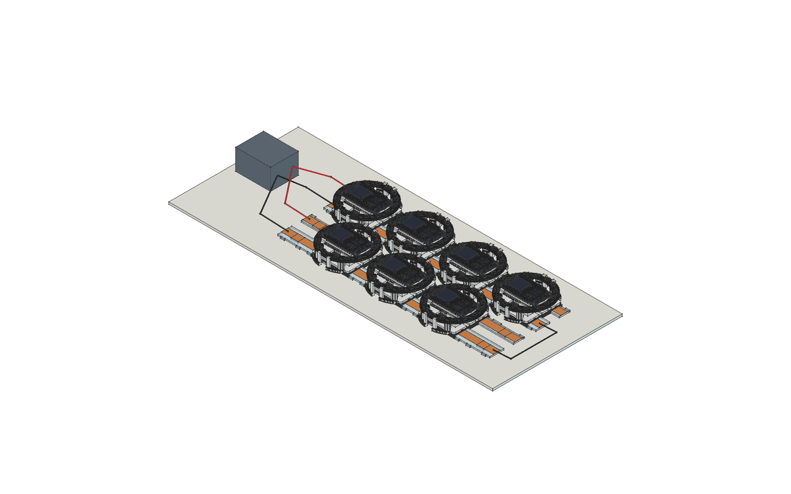
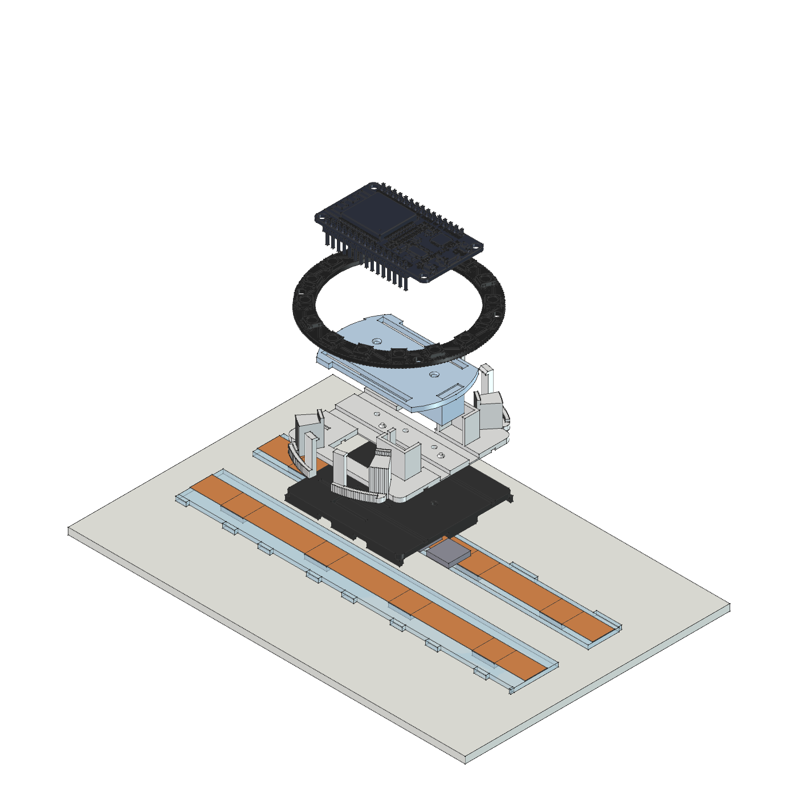
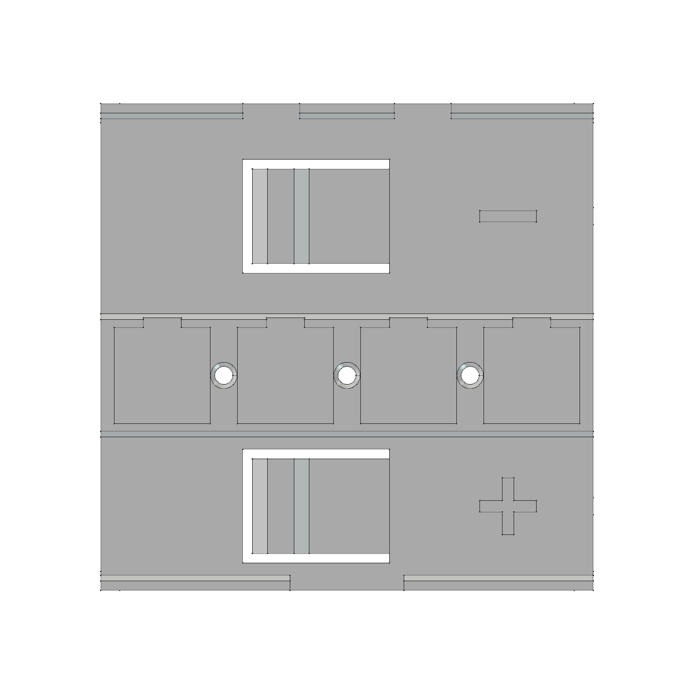
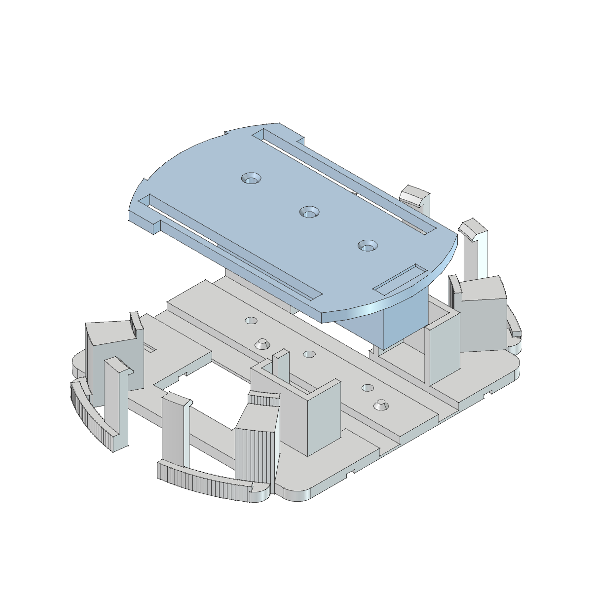

# HexNode RGB Wall

An interactive LED wall from Maker's Asylum, developed from the [DevCon8 2026 RGB Interactive Wall](https://github.com/MakersAsylumIndia/DevCon8_RGB_Wall). Each node is one ESP32, one 16-LED WS2812B ring and one touch input. Touching a node should send light ripples across the wall. The nodes talk to each other over ESP-NOW, so the wall only has to carry power.

**This is version 03.** Nothing in v03 has been printed yet. It follows the reference model `v03_suggestion.FCStd`. v01 and v02 are archived in [`archive/`](archive/).

- **The wall.** A magnetic whiteboard with an insulating face. Each row of nodes has two laser-cut acrylic strips, held on by 10 × 10 × 2 mm magnets in pockets, with 10 mm copper tape along each strip: **+5V on the narrow top strip, GND on the wide bottom strip.**
- **The node.** A one-piece printed **bracket** sits over the two strips and is held to the board by four magnets. Two sprung copper-taped tabs press on the rails. A printed **carrier** holding the ESP32 and the LED ring is superglued on top.
- **Polarity.** The bracket has a 14.6 mm channel for the +5V strip and a 20.6 mm channel for the GND strip. Turned upside down, the narrow channel can't go over the 20 mm strip, so the node doesn't seat. Mounting it face down isn't possible because the LEDs would face the wall.

## The wall

| | |
|---|---|
| Whiteboard | Magnetic, with an insulating face (so the magnets and tape can't short through it) |
| +5V strip | Acrylic, 14 × 1.8 × 570 mm, with magnet pockets every 38 mm and an 11.4 mm key tab on its top edge every 38 mm |
| GND strip | Acrylic, 20 × 1.8 × 570 mm, with the same pockets and a pair of 5.4 mm key tabs (10 mm apart) on its bottom edge every 38 mm |
| Gap between a row's strips | 13.6 mm (the bracket's tongue + 0.3 mm each side) |
| Row pitch | 65.8 mm (node pitch 76 mm, hexagonal; alternate rows offset by 38 mm) |
| Magnet pitch | 38 mm = half the node pitch, so every node sees the same magnet pattern under it |

1. Laser-cut the strips from 1.8 mm acrylic ([`export/laser/`](export/laser/)). Check that a magnet is a tight push fit in the cut pocket; the kerf decides this, so change `AcrMagHole` if needed.
2. Cut a few **rail gauges** (`Rail_gauge_any_sheet.dxf`, any sheet). The gauge is a comb: lay two across the board, drop the strips into its slots, and the gaps between strips and the row pitch come out right. Its fingers are 10 mm wide, so they fit between the key tabs.
3. Lay the strips on the board, push the magnets into the pockets, then run copper tape along the full row centred on each strip, over the magnets and across the joints between strips.
4. Solder a red and a black wire to the left end of each row's tapes and take them to the 5V/5A SMPS. Loop the GND tapes of all rows together with wire as well (shown on the right in the render).

The key tabs stick out 1.5 mm and are centred on the node positions. The bracket has matching notches, so a node only seats at a node position and only the right way up. Strips butt end to end: the +5V tab at each end is half a tab, and two halves make one.

The magnets sit in the middle of each strip with at least 2 mm of acrylic round them. The nearest bare tape on the other rail is 24.6 mm away, so a magnet can't bridge +5V and GND.

## The node

### Bracket (one printed part)

- **Tongue.** Sits on the board between the two strips and holds four 10 × 10 × 2 mm magnets in a row (13 mm pitch).
  - `Bracket_v03_pocket`: the magnets press into 10.15 mm pockets that are open on the board side, with a dab of superglue. Each magnet touches the board, which gives the strongest hold. Each pocket has a 4 mm wide, 1 mm deep notch in its GND-side wall: wedge a small screwdriver in there to lever a magnet out.
  - The embedded-magnet variant (magnets sealed in during the print, with a pause at Z 4.2) is archived in [`archive/v03_embed/`](archive/v03_embed/).
- **Lips.** The lips run down the outside of both strips. Together with the tongue they make a narrow channel and a wide one, which sets the polarity. The +5V lip has one 12 mm notch and the GND lip has two 6 mm notches 10 mm apart. These drop over the strips' key tabs: a second polarity key, and it fixes the node on the 38 mm grid.
- **Contact tabs.** There are two, 14.5 × 10 × 1.2 mm (10 mm wide, to match the copper tape), cantilevered along the rail. They are shorter than before so that the base's tab windows stay clear of the JST pockets. The pad at the free end sits 1.2 mm below the tape surface, so a seated tab is bent up by **1.2 mm**: about 3.4 N of contact force, 1.0 % strain in PETG. The slot is 1.0 mm along the sides and 2.5 mm past the free end, for wrapping the copper tape round it. Each tab has a 1.8 × 0.7 mm groove along its top for the wire, running out to the bracket's edge. The base has the same groove underneath, so together they make a tunnel.
  1. Stick copper tape along the tab top, round the free end and over the pad.
  2. Lay the stripped wire in the groove.
  3. Put a second layer of tape over it.
- **Rivet holes.** There are three 2.1 mm holes, one in each wall between the magnets, so 1.75 mm filament pushes through by hand. They run on through the base and the deck. Push the filament through all three parts, then melt the ends into heads. Each hole has a 0.35 mm countersink at the magnet end and a 0.6 mm one on the deck face, so the heads sit flush. There is also a 0.3 mm chamfer on print-bed faces against elephant's foot. The holes are off the node centre, so turned 180° they miss by 6 mm.
- **Signs.** The + and − are cut right through the plate, in line with the same signs in the carrier base, so they read from the wall side and from the front, and line up when the parts are stacked.

The bracket prints **top face down** (flat on the bed), with no supports.

### Carrier (two printed parts, glued to each other and to the bracket)

The carrier is split so both halves print without supports:

- **A, base** (`Carrier_v03_A_base`): prints plate down.
  - **Plate** with ring clips and windows over the contact tabs.
  - **Wire channels.** Two 4.5 × 1.5 mm channels on the top, one beside each window. Each runs only from its JST pocket to the USB-end edge, so the rest of the plate keeps its full 2 mm thickness. There is also a groove underneath on each tab line.
  - **JST pockets.** Two three-sided pockets drawn round the real JST XH 3P housing (`ref/XH_housing_3P.step`, shown in the model as `JSTEnv3`). Both housings sit the same way round: mating face up, wire end down, latch ribs towards −y and the flange lip towards +y. The walls are 2 mm thick, with a 0.8 mm groove at flange height. The housing slides in from the open side (towards the node centre), with its lip running in the groove, so it can't move up or down. Clearance is 0.1 mm on the body, 0.2 mm round the lip edges and 0.25 mm above and below the lip (the groove is 1.1 mm tall). The housing ends 3.25 mm above the plate, and the floor under it is recessed 1.5 mm, so the wires have room to bend out into the channel. The walls reach up to 0.2 mm below the ESP32 header plastic. The neighbouring header pin passes down through a slot in the inner end wall.
  - **Rivet holes** and two **detent cones**.
  - **+ and − signs**, cut right through, in line with the bracket's.
- **B, deck** (`Carrier_v03_B_deck`): prints deck face down, with one block pointing up. The block carries the three rivets and has sockets for the detent cones. The deck is thicker round the two header slot ends at the antenna end, where it broke, and 1.6 mm wider outside the slots there.

**Locating.**
- **Base to deck:** two off-centre cones and sockets, plus the rivets.
- **Bracket to base:** both faces print on the bed, so neither can carry a printed tab without supports. The three rivets do the locating there: they are off centre, so the parts only line up one way.

**The LED ring.** Four sprung clips hold it at its ID and OD, as in v02, and take rings within **±1 mm** of the measured `LedRingID` and `LedRingOD`. The ring sits 2 mm behind the ESP32's PCB, so the ESP32 sits inside the ring and stays fully visible. Near the thickened deck corners, a ring at the small end of the range (ID 53) is a tight fit over the deck.

Assembly:
1. Slide the two JST housings into their pockets on the base from the open side, wire end down, with the lip in the wall groove. Both face the same way.
2. Glue the deck onto the base on the detents.
3. Lay the wires in the tab grooves and the channels, and tape the tabs.
4. Stack the bracket, base and deck, push filament through the three rivet holes, and melt the heads. Trim the magnet-end heads flush, since the bracket must sit flat on the board.
5. Snap the ring in from the front.
6. Press the ESP32 in from the top. Its header strips go into the deck slots, and the six pins nearest the USB end plug into the JST housings.

The whole node stands 23.7 mm off the board. Neighbouring carriers are 3.6 mm apart.

### Node wiring

The wires are modelled in the `V03Wiring` group (26 AWG, 1.2 mm), with the touch washer and foam. Both JST housings face the same way. Pin 1 is the pin nearest the USB end. Each wire leaves its housing straight down, runs in the floor recess and the base channel, and comes out at the USB-end edge. The base top has raised **PWR** and **LED** labels beside the two pockets (Liberation Sans Narrow Bold, 3.2 mm letters, 0.6 mm high; `LabelH`, `LabelD`).

The wires are cables from the **Cables workbench** (sargo-devel/Cables, installed through the Addon Manager). Each one is a single 26 AWG conductor with 2 mm of bare copper at both ends. Each follows a smooth path, `wire_path()` in `v03.py`: straight runs joined by tangent bends of 1.5 mm radius, smaller where a run is short. That path is kept hidden as `WPath_*`. The Cables workbench only works with the FreeCAD window open, so a headless rebuild draws plain swept wires on the same paths. After a headless rebuild, run `v03.cable_wiring(App.ActiveDocument)` in the FreeCAD window to swap the plain wires for real cables and relink the demo wall. Render: `export/renders/v03_wiring_cables_iso.png`.

| Plug | Pin | Colour | ESP32 | Goes to |
|---|---|---|---|---|
| PWR (bottom row) | 1 | red | VIN | +5V contact tab: round the USB end, in along the tab groove, ends on the top of the tab under the copper tape |
| PWR | 2 | black | GND | GND contact tab, the same way |
| PWR | 3 | yellow | D13 | Touch washer: back over the base top beside the PWR pocket, up past the ESP32's side (inside the ring) to the washer |
| LED (top row) | 1 | red | 3V3 | Ring VCC pad |
| LED | 2 | black | GND | Ring GND pad |
| LED | 3 | yellow | D15 | Ring DIN pad |

- **Ring orientation.** The ring is turned 90° (`RingTwist` = −90), so its four back pads sit in the wide gap between the two clips at the USB end, right where the LED wires come out. Seen from the front, the pads run counter-clockwise DIN, VCC, GND, DOUT, as in the circuit diagram. Check this on your ring. The LED wires are staggered in height, so they don't cross.
- **Touch washer.** 25 mm OD × 10 mm ID (1.5 mm thick assumed), on a 3 mm laser-cut foam disc of the same diameter, centred on the ESP32-WROOM shield. This adds about 4.5 mm to the front of the node (front at 28.2 mm off the board).

With the USB socket pointing right and the ESP32 facing you, the VIN/GND/D13 header row is the **bottom** one. Check this on your board. Put a 470–1000 µF capacitor across VIN and GND.

## Power

| | |
|---|---|
| Per node, worst case | 16 LEDs × 60 mA × 90/255 (firmware brightness) ≈ 0.34 A, plus the ESP32 ≈ 0.15–0.25 A, so about **0.5 A** |
| Per 5V/5A SMPS | Up to 10 nodes |
| Tape drop | 10 mm × 0.035 mm copper is about 0.05 Ω/m per tape. Ten nodes along 0.76 m, fed from one end, lose about 0.2 V across +5V and GND together. Feed long rows from both ends. |
| Fuse | One resettable fuse per SMPS output, for example Yageo BK30-500 (5 A) |

## Parts and sourcing

Prices were checked on 15 Nov 2026. "Unverified" means the price came from a search snippet, not a product page. Magnet and acrylic prices haven't been checked.

| Part | Source | Price |
|---|---|---|
| Copper tape, 10 mm, conductive adhesive | [Robocraze](https://robocraze.com/products/10mm-conductive-copper-tape-adhesive), [Electroncomponents 10 mm × 30 m](https://www.electroncomponents.com/copper-double-sided-tape-30m-10mm) | ₹306; ₹249 + GST |
| 1000 µF 16–25 V capacitor | [Robocraze 25 V](https://robocraze.com/products/1000uf-25v-electrolytic-capacitor-through-hole-dip), [Evelta 16 V](https://evelta.com/1000uf-16v-electrolytic-capacitor) (sold out) | About ₹6 (unverified) |
| Resettable fuse, 5 A / 3 A | [Yageo BK30-500](https://www.digikey.in/en/products/detail/yageo/BK30-500-SZ/15855858), [BK30-300](https://www.digikey.in/en/products/detail/yageo/BK30-300-SZ/13689577) | ₹51 / ₹35 (unverified) |
| Neodymium magnets 10 × 10 × 2 mm, 4 per node and 2 per 38 mm of row | Not yet checked | |
| Acrylic sheet 1.8 mm (strips), any sheet (gauge) | Local | |
| Magnetic whiteboard, insulating face | Local | |

## Files

| Path | What |
|---|---|
| [`HexNode_RGB_Wall.FCStd`](HexNode_RGB_Wall.FCStd) | FreeCAD 1.1 model. `V03Params` (spreadsheet), `V03Parts`, `V03Demo` (two rows), `ExplodedNodeV03` |
| [`v03_suggestion.FCStd`](v03_suggestion.FCStd) | The hand-made reference that v03 follows |
| [`scripts/v03.py`](scripts/v03.py) | Builds everything: `v03.build(doc)`, `v03.checks(doc, p)`, `v03.export_v03(doc, "export")`. It uses `v02.py` for the ring clips and `wall.py` for helpers |
| [`export/guide/`](export/guide/) | **Assembly guide** `HexNode_v03_assembly_guide.pdf` (and .html), 19 pages. Pictures: `scripts/render_guide_v03.py` (run in FreeCAD); layout + PDF: `scripts/make_guide_v03.py` |
| [`export/print/`](export/print/) | `Bracket_v03_pocket.stl`, `Carrier_v03_A_base.stl`, `Carrier_v03_B_deck.stl`, in print orientation |
| `export/print/*_P1S.gcode.3mf` | Sliced for a Bambu P1S, PETG, 0.2 mm, textured PEI: `HexNode_v03_node_pocket_P1S` (pocket bracket + both carrier parts on one plate, 3 walls, 30 % gyroid, 54 min, 21.4 g) |
| `export/print/Carrier_v03_A_base_PLA_P1S.gcode.3mf` | Carrier base alone in PLA: 3 walls, 30 % gyroid, 24 min, 8.7 g |
| `export/print/HexNode_v03_2sets_PETG_P1S.gcode.3mf` | Two full node sets (2 x pocket bracket + base + deck) on one plate, PETG, 3 walls, 30 % gyroid, 1 h 47 min, 42.6 g |
| `export/laser/*.lbrn2` | LightBurn projects made by `scripts/lightburn.py`: 4 +5V and 4 GND strips on one 1.8 mm sheet, and 2 rail gauges. Power and speed are placeholders |
| [`export/step/`](export/step/) | The same parts as STEP |
| [`export/laser/`](export/laser/) | `Plus_strip_1.8mm_x570.dxf`, `Gnd_strip_1.8mm_x570.dxf`, `Rail_gauge_any_sheet.dxf` |
| `export/laser/HexNode_v03_proto_1.8mm.lbrn2` | One-node prototype on one 1.8 mm sheet: a 103 mm +5V strip and a 103 mm GND strip, each with two magnet pockets, its key tabs, an engraved label and an M3 terminal hole on the tape centre line 7 mm from the right end, plus two one-row rail gauges. Made from `Proto_*.dxf` by `v03.export_proto(doc, "export")` and `python3 scripts/lightburn.py --proto`. Start the copper tape 22 mm from the label end, so the label stays visible. |
| `export/laser/HexNode_v03_rows_3+2_1.8mm.lbrn2` | Small wall on one 1.8 mm sheet, with separate strips for odd and even rows. Row 1 (odd, 3 nodes): a 280 mm +5V strip and a 280 mm GND strip with 6 magnet pockets each. Row 2 (even, 2 nodes): strips made the same 280 mm length by extending them to the right, with 6 pockets each. In a set, every strip ends where the longest row ends. With equal lengths, the odd and even strips come out identical, because pockets and key tabs repeat every 38 mm. Also two 2-row rail gauges. Even-row nodes sit half a node pitch (38 mm) along from odd-row nodes. Every strip starts at the same wall x, so all rows line up along their **left** (and right) ends: set them against a straight edge and space them with the rail gauges. Each end has a 3.2 mm hole (M3 screw + ring lug) on the tape centre line, 38 mm beyond the outermost node, with +5V or GND engraved beyond it. Run the copper tape over both holes. Made from `Row*_{odd,even}_*_strip_*.dxf` and `Rows2_rail_gauge.dxf` by `v03.export_rows(doc, "export", rows=(3, 2))` and `python3 scripts/lightburn.py --rows`. Preview: `export/renders/laser_rows_3+2_preview.png`. |
| [`export/renders/`](export/renders/) | Pictures used here |

## Changing the design

Edit `V03Params` in the FreeCAD file, then run `v03.build(doc)` and `v03.export_v03(doc, "export")`. The main values:

| Parameter | Default | What |
|---|---|---|
| `LedRingID`, `LedRingOD` | 54, 68 | **Measure your ring.** Clips take ±1 mm (`RingTol`) |
| `PlusW`, `GndW` | 14, 20 | Strip widths. Keep them different by at least 4 mm |
| `RailT` | 1.8 | Strip acrylic |
| `AcrMagHole`, `MagPocket` | 9.75, 10.15 | Magnet pockets in acrylic (as drawn; 10.0 drawn cut to 10.25 on our laser, so 9.75 cuts to about 10.0) and in the print |
| `CtTabW`, `CtTabL`, `CtTabT`, `CtPreload` | 10, 14.5, 1.2, 0.4 | Contact tab width, length, thickness and seated deflection. `CtPreload` was 1.2: the contact pads stood 0.8 mm taller and the tabs flexed too far |
| `LabelH`, `LabelD` | 3.2, 0.6 | Raised PWR / LED letter height and how far they stand above the base top |
| `KeyPlusW`, `KeyGndW`, `KeyGndGap` | 12, 6, 10 | Polarity notches in the bracket lips (and the strips' tabs) |
| `RivetHole` | 2.1 | Filament rivet holes (hand push fit for 1.75 mm; 2.0 printed too tight) |
| `JstW`, `JstBodyW`, `JstH`, `JstFlangeT` | 9.8, 8.2, 7.75, 0.6 | JST XH 3P housing (from its STEP) |
| `JstClr`, `JstLipClr`, `JstGrooveClr`, `JstWall` | 0.1, 0.2, 0.25, 2.0 | JST pocket fit (body, lip edges, above/below lip) and wall thickness |
| `NodePitch3` | 76 | Node pitch; the row pitch and magnet pitch follow |
| `JstGap` | 13.5 | Carrier plate to ESP32 PCB (headers and JST plugs) |

`v03.checks` reports the following. With the defaults:
- Bracket against rails: only the pads touch (by the preload).
- Upside-down bracket against rails: 330 mm³ overlap, so it won't seat.
- Bracket moved 10 mm off a node position: 133 mm³ overlap with the key tabs, so it won't seat.
- Carrier against bracket, ESP32 and JST housings: 0. Base against deck: 0. ESP32 pins against the JST pocket walls: 0.
- ESP32 against ring: 0.
- Ring clips at ID 53–55 and OD 67–69: only the hooks touch.

## Version history

- **v01** (17 Nov 2026), archived in [`archive/v01/`](archive/v01/): French cleat rail strips, a node back with copper-tape or pogo pin contacts, and the original holder extended with posts and snap arms. Test prints showed that the holder's snap arms broke and that its posts blocked the JST plugs.
- **v03 embedded-magnet bracket** (archived 21 Nov 2026) in [`archive/v03_embed/`](archive/v03_embed/): the magnets were sealed in during the print behind a 0.5 mm skin, with a pause at Z 4.2. Dropped in favour of the pocket bracket.
- **v02** (17–18 Nov 2026), archived in [`archive/v02/`](archive/v02/), with everything in `HexNode_RGB_Wall_v02_bundle.zip`. These were test parts and had not been printed: wire catches on the rail, a bayonet twist-lock between the node back and a new carrier, the ESP32 held by its header strips, the ring held at its edges by four sprung clips, an optional clear acrylic touch cover, and acrylic options for the carrier and rail.
- **v03** (18 Nov 2026), current: magnetic whiteboard, acrylic rails with copper tape and magnets, and polarity keyed by the strip widths. The node is a magnetic one-piece bracket with sprung tape tabs, plus a glued-on carrier that reuses v02's header slots and ring clips.

## License

Licenses

#### Hardware
CERN Open Hardware License Version 2 - Strongly Reciprocal ([CERN-OHL-S-2.0](https://spdx.org/licenses/CERN-OHL-S-2.0.html)).

#### Software
MIT open source [license](http://opensource.org/licenses/MIT).

#### Documentation:
 This work is licensed under a <a rel="license" href="http://creativecommons.org/licenses/by/4.0/">Creative Commons Attribution 4.0 International License</a>.
