# HexNode RGB Wall (v01)

> **Archived version v01** (17 Nov 2026). This folder is a snapshot: the model is `HexNode_RGB_Wall_v01.FCStd`, the scripts are in `scripts/`, and the print files in `export/` carry a `_v01` suffix (for example `export/Node_back_v01.stl`). File names in the text below refer to the unsuffixed names in the live project.

An interactive LED wall from Maker's Asylum, developed from the [DevCon8 2026 RGB Interactive Wall](https://github.com/MakersAsylumIndia/DevCon8_RGB_Wall). Each node is one ESP32, one 16-LED WS2812B ring and one copper-tape touch pad. Touching a node should send light ripples across the wall. The nodes talk to each other over ESP-NOW, so the wall only has to carry power.

The design has two halves:

- **The wall.** Printed rail strips go in horizontal rows on any non-conductive wall, held by screws or double-sided tape. Each strip has two rails. Bare copper wire on the top rail carries GND, and on the bottom rail +5V.
- **The node.** The ESP32 and ring sit in the original holder. A printed node back snaps onto the holder, hooks over the top rail, and snaps under the bottom rail. Two spring contacts on the node back press on the wires.

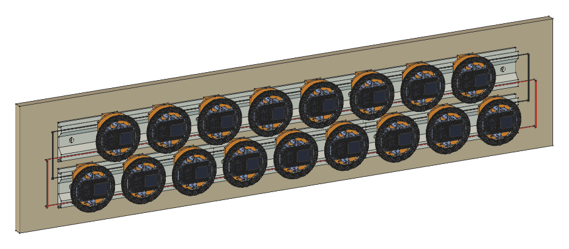

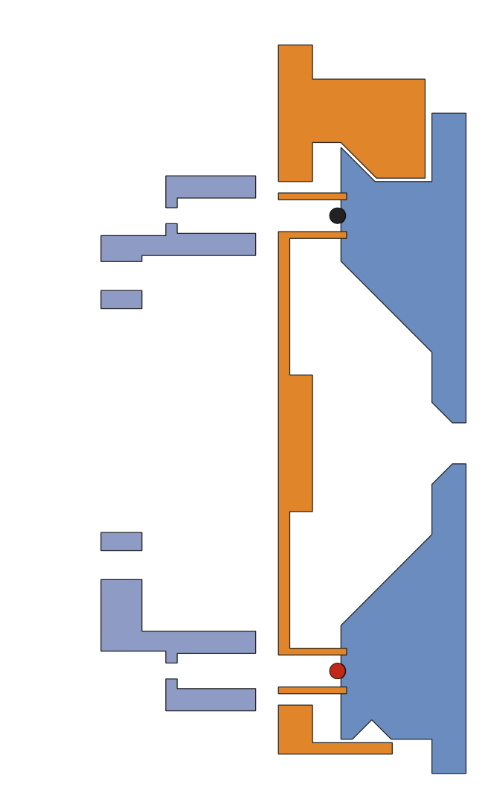 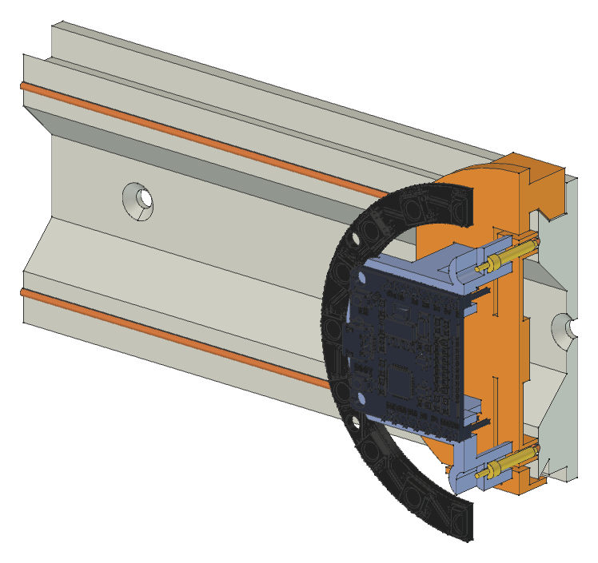

## The wall

- **Rail strips.** Each strip is 240 × 58 mm (to fit a 256 mm print bed) and carries both rails for one row. Strips butt end to end.
  - Three countersunk holes per strip take M3.5 or #6 wood screws. They sit between the rails, behind the nodes. A flat back also takes VHB tape.
  - Strips print on their back, without supports. Every overhang is 45°.
- **Layout.** Hex-offset rows, 80 mm apart along a row and 69.3 mm between rows (80 × √3/2). Alternate rows shift by 40 mm. Rails are continuous, so a node can go anywhere along a row.
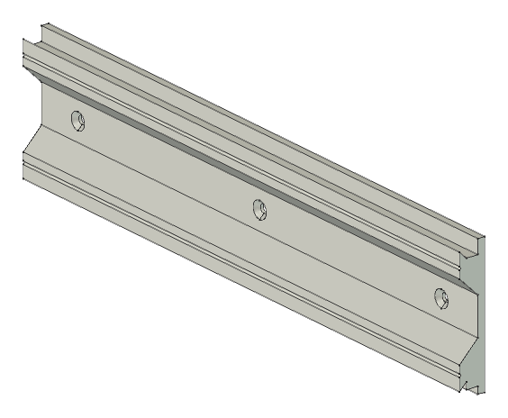

- **Top rail (GND).** A French cleat: a 3 mm 45° lip at the front, then a flat shelf back to the base. The node's hook sits on the shelf and behind the lip. A 45° brace underneath ties the rail into the base, so its root is 15 mm tall.
- **Bottom rail (+5V).** A 45° brace on top ties it into the base. A V-groove runs along its underside, 1 mm behind the front edge, shaped to match the node's latch barbs with 0.15 mm clearance.
- **Polarity key.** Apart from that V-groove, the bottom rail is solid underneath. A node turned upside down would need its hook to fit into the rail, so it collides instead (at least 93 mm³ of overlap at every height checked). It can't be hung with the polarity reversed.
- **Conductors.** Bare solid copper wire runs the full length of each row: 1.5 mm² solid house wire, Ø1.38 mm. It sits in a shallow groove and stands 1 mm proud of the rail face.
  - Pull the wire straight and taut, anchor it at both row ends, and put a drop of CA glue on each strip. The contacts press it into the groove, so it doesn't need a snap fit.
- **Edge loops.** At both ends of the wall, insulated wire ties together all the GND rails and all the +5V rails. Feeding every row from both ends halves the voltage drop.

## The node

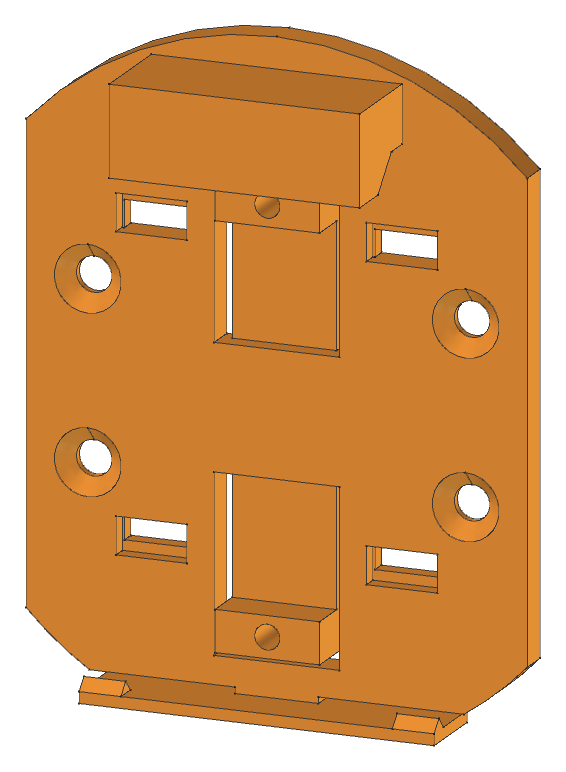 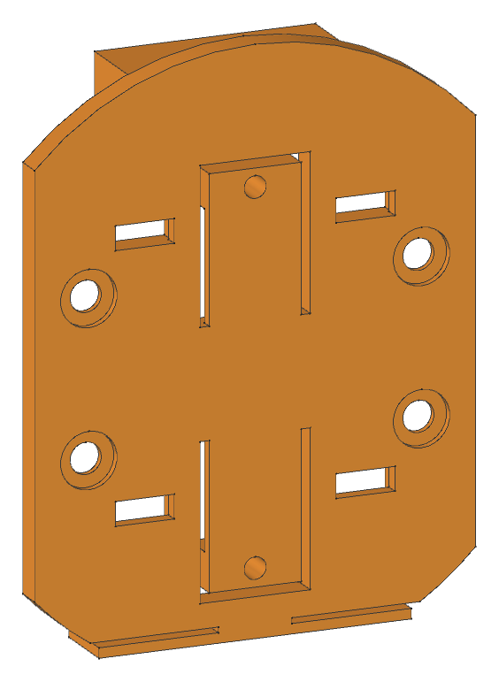

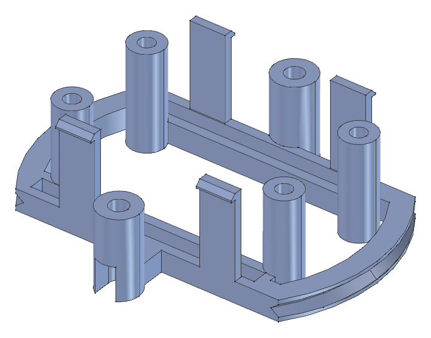 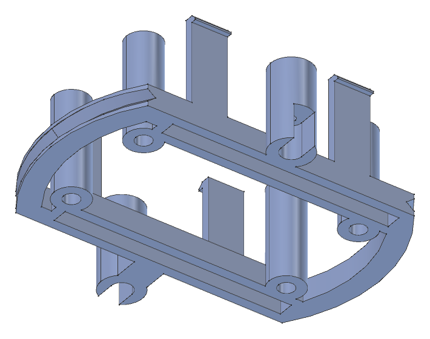

- **Two printed parts per node, no screws.** Both print flat with no supports.
  - **Holder:** the original holder, with its four bosses extended into 12 mm posts, four snap arms added on its long edges, and two pogo pin bosses.
  - **Node back:** a 3 mm plate, 48 × 62 mm with rounded ends, hidden behind the 68 mm ring. The same plate works with either contact option.
- **How they join.** The posts sit in 0.8 mm pockets in the plate, which locate the holder. The snap arms go through slots in the plate, and their barbs click into pockets on the wall side, flush with the face.
  - Each barb overlaps the plate by 1.3 mm. Pushing them together takes about 27 N in total, at 1.8 % strain in the 1.2 mm arms. To separate them, press the barbs in.
  - Each post keeps its Ø2.65 bore, and the plate has a plain Ø3.4 hole at each post, so an M3 × 18 pan or flat head screw from the wall side still works as a fallback. The heads sit between the rails.
- **Wiring room.** The 12 mm posts leave 8 mm above the ESP32 header pins.
- **Hook.** A solid block that sits on the cleat's shelf and lip with 0.3 mm clearance. It stands 6 mm above the lip, and its tip reaches back to within 0.6 mm of the base.
- **Latch.** A T-shaped spring under the bottom rail, with two 15 mm arms 1.0 mm thick and a barb on each end.
  - Each barb is a 45/45° triangle, 1.8 mm tall and 5 mm wide, that seats in the rail's matching V-groove. Once latched, the node can move only about 0.2 mm.
  - Snapping in needs about 9 N, at 1.2 % strain.
  - The 45° catch lets go with a firm pull of about 17 N on the node's bottom edge. There's no tab to press.

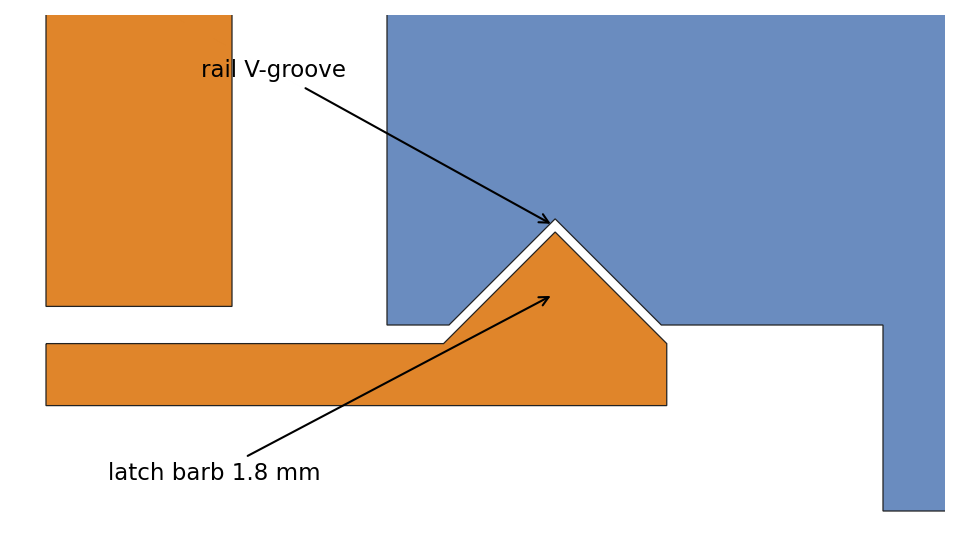
  - These forces are estimates. Print one and adjust `LatchT` or `LatchE`.
- **Hanging a node.** Tilt the bottom out, hook the top over the top rail, and swing the bottom in until the latch clicks.
  - I checked the path: at 30° tilt the node hooks on 4 mm high, then lowers as it swings in. Nothing collides except the latch barbs as they snap.
- **Contact order.** GND, on the top rail, touches first when a node is hung and breaks last when it's removed.

### Two contact options, one set of parts

Each rail has a vertical spring tab on the node back, ending in a flat 10 × 4 mm pad with a Ø2.8 mm hole through it. Unflexed, the pad stands 3 mm proud of the plate and reaches 0.5 mm past the rail face, so it is pushed back 1.5 mm by the wire. Next to each pad, a pogo pin boss on the holder lines up with the hole. Pick the contact option at assembly time; the printed parts are the same.

| | Copper tape | Pogo pins |
|---|---|---|
| Contact | Copper tape wrapped over the pad, spanning the hole. The pad lies along the wire, giving 10 mm of line contact. As the tab bends, the pad tilts about 9° about an axis parallel to the wire, so the contact stays along its full length. The 4 mm pad height tolerates some vertical misalignment. | The pin sits in the holder boss and reaches the wire through the hole in the pad. It goes in tail first from the boss's open end, and the spring pushes its collar onto a shoulder. The collar is a light press fit, so the pin stays put while the node is apart. |
| Preload | 1.5 mm tab deflection, about 4.8 N, 1.2 % strain (1.0 mm tab). Copper tape adds its own thickness on top. | 1.8 mm of the pin's 3 mm stroke, about 0.9 N. The bare pad also rests on the wire. |
| Wiring | Wrap the tape round the tab's end to the node side and solder a wire there. | Solder a wire to the 2 mm of tail that sticks out into the window under each boss. |
| Cost per node | About ₹2 of tape | About ₹35 imported, plus shipping and duty; about ₹260 from India (2 pins) |
| Contact detail | 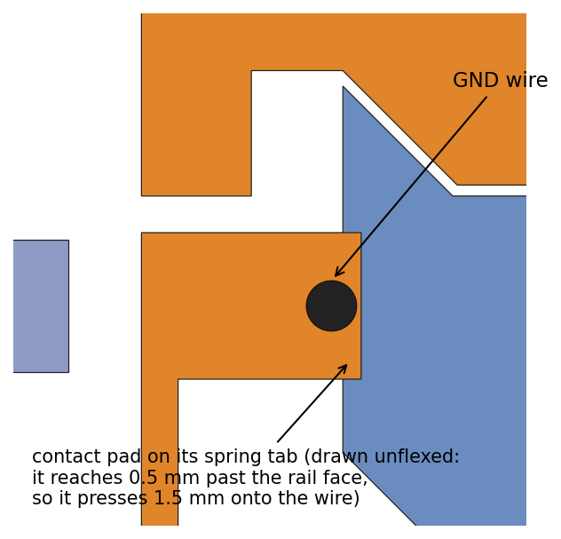 | |
| Watch out for | A plastic spring relaxes over time. Print the node back in **PETG**, not PLA, and re-check contact after a few weeks. | The Ø1.2 mm domed tip has to land on a Ø1.4 mm wire. The hook sets the height to about ±0.3 mm, which should be enough, but check the first prints. |

Designed around the **CHIN-BAN PG1000-01-012P** pin ([LCSC C49451495](https://www.lcsc.com/product-detail/C49451495.html), [datasheet](https://www.lcsc.com/datasheet/C49451495.pdf)): 2 A, Ø2.0 barrel, Ø3.0 × 2.0 mm collar, 3.0 mm stroke, 16.2 mm long. The bosses are sized for it: Ø3.1 bore for the collar, 1 mm shoulder, Ø1.4 tail hole. For a different pin, change the `Pin*` cells.

**Node wiring.** Connect the top contact to ESP32 GND and the bottom contact to VIN; the ring is powered from the ESP32 as before. Put a 470–1000 µF capacitor across VIN and GND at the header pins. It absorbs the surge and contact bounce when a node is hung on a live wall, which can otherwise kill the first LED.

## Power

| | |
|---|---|
| Per node, worst case | 16 LEDs × 60 mA × 90/255 (firmware brightness) ≈ 0.34 A, plus ESP32 with ESP-NOW ≈ 0.15–0.25 A, so about **0.5–0.6 A** |
| Row of 9 nodes | About 5 A |
| Rail drop | 1.5 mm² copper is 0.0115 Ω/m. On a 0.72 m row fed from both ends, the drop is about **10 mV** across +5V and GND together. Copper tape (5 mm × 0.035 mm) would be about 8× worse. |
| Contact drop | Pogo pin ≤ 100 mΩ, so ≤ 0.1 V for both contacts at 0.5 A |
| Supply | 5 V, sized at 0.6 A per node plus 20 % (the demo wall's 17 nodes need about 12 A). Put one resettable fuse per row: Yageo BK30-500 (5 A) or BK30-300 (3 A). |

## Parts and sourcing

Prices were checked on 15 Nov 2026. "Unverified" means the price came from a search snippet, not a product page. AliExpress currently won't ship to India.

**Pogo pins**

| Part | Source | Price | Notes |
|---|---|---|---|
| CHIN-BAN PG1000-01-012P (design pin) | [LCSC C49451495](https://www.lcsc.com/product-detail/C49451495.html) | $0.20 at 100, $0.19 at 500 (about ₹17) | 2 A, plain tail. Add about $20–35 DHL shipping and roughly 30–40 % duty + IGST. Do DHL India KYC first. |
| HJ Tech 2LC000-743 | [LCSC C54935118](https://www.lcsc.com/product-detail/C54935118.html) | $0.20 at 100 | 2 A, 8.8 mm. Needs different `Pin*` values. |
| Mill-Max 0973-0-15-20-77-14-11-0 | [DigiKey India](https://www.digikey.in/en/products/result?keywords=0973-0-15-20-77-14-11-0) | ₹129 at 100 (before GST) | 2 A, solder cup, press-fit barb, ships from stock in India. Needs different `Pin*` values. |
| P75-H2 probe + R75-3S receptacle | Probots: [probe](https://probots.co.in/p75-h2-pogo-pin-with-serrated-head-tip-for-pcb-testing-connector.html), [receptacle](https://probots.co.in/r75-3s-pogo-pin-receptacle-solder-type-female-socket-connector-pcb-test-probe.html) | ₹35 + ₹99 | 3 A, but Ø1 mm parts are fiddly to fit in a print |

**Other parts**

| Part | Source | Price |
|---|---|---|
| Copper tape, 10 mm, conductive adhesive | [Robocraze](https://robocraze.com/products/10mm-conductive-copper-tape-adhesive), [Electroncomponents 10 mm × 30 m](https://www.electroncomponents.com/copper-double-sided-tape-30m-10mm) | ₹306; ₹249 + GST |
| Bare copper wire, about Ø1.4 mm (17 SWG) or 1.5 mm² solid | Local wire shops: ask for **solid** core, since most 1.5 mm² wire is stranded. [IndiaMART listings](https://m.indiamart.com/impcat/bare-copper-wire.html) | About ₹700–1,200/kg (unverified); 1 kg is about 75 m |
| 1000 µF 16–25 V capacitor | [Robocraze 25 V](https://robocraze.com/products/1000uf-25v-electrolytic-capacitor-through-hole-dip), [Evelta 16 V](https://evelta.com/1000uf-16v-electrolytic-capacitor) (sold out) | About ₹6 (unverified) |
| Resettable fuse, 5 A / 3 A | [Yageo BK30-500](https://www.digikey.in/en/products/detail/yageo/BK30-500-SZ/15855858), [BK30-300](https://www.digikey.in/en/products/detail/yageo/BK30-300-SZ/13689577) | ₹51 / ₹35 (unverified) |

## Building it

1. **Print.**
   - Rail strips on their back, in PLA or PETG.
   - Node backs node-side down, in **PETG**: the latch and tape tab are springs.
   - Holders flat, with the posts and arms pointing up.
   - All the STLs in `export/` are already in print orientation.
2. **Mount the strips.** Draw level lines 69.3 mm apart. Screw or tape the strips on, butted end to end, with the cleat (top rail) at the top.
3. **Lay the wire.**
   - Straighten the solid wire by pulling it, press it into the grooves, and anchor it at both row ends.
   - Put a drop of CA glue on each strip.
   - Top rail is GND, bottom rail is +5V.
4. **Wire the edge loops.** At both ends, join all GND rails and all +5V rails with insulated wire, and feed power in through a fuse per row.
5. **Fit the contacts.**
   - Tape: wrap 10 mm copper tape over the pad and round the tab's end, then solder a wire on the node side.
   - Pogo: push the pin tail-first into the holder boss until the collar meets the shoulder, then solder a wire to the tail through the window. Do this before snapping the holder onto the node back.
6. **Wire the node.** Top contact to GND and bottom contact to VIN, plus the capacitor.
7. **Assemble the node.** Push the holder's posts into the node back's pockets until the four arms click.
8. **Hang it.** Hook the top over the top rail and swing the bottom in until it clicks. To remove a node, pull its bottom edge firmly, then lift it off.

## Holder features

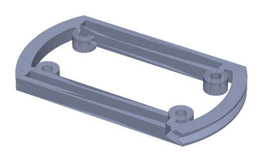 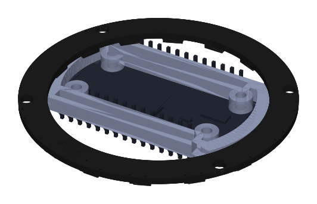

- **Header slots.** Two 2.54 × 38.1 mm slots, 25.4 mm apart, for the two 15-pin rows of the ESP32 DevKit V1 (30-pin).
- **Ring snap.** The ends reach 0.6 mm past the ring's inner edge. A 90° V-groove, 1.5 mm wide at the ring edge, takes the ring PCB at mid-thickness.
- **Screw bosses.** Four Ø5.85 mm bosses with Ø2.65 mm holes (M3 self-tapping) on a 40 mm circle.
- **Central window.** It widens at the +X end.
- **Parametric.** Every dimension is a cell in the `Params` spreadsheet. The holder's length follows the ring size, and the slot length follows the pin count.

## Files

| File | What it is |
|---|---|
| `HexNode_RGB_Wall.FCStd` | The FreeCAD model, described below. |
| `export/Rail_strip.stl`, `export/Node_back.stl`, `export/Holder_wall.stl` | Wall and node print files, already in print orientation. `Holder_wall` is the holder with posts, snap arms and pin bosses; use it instead of `HexNode_holder` on the wall. |
| `export/HexNode_holder.stl` | Holder print file, lying flat, no supports. |
| `export/*.step` | The same parts for other CAD tools. |
| `scripts/hexnode.py` | Builds, checks and exports the holder. |
| `scripts/wall.py` | Builds, checks and exports the rail strip, node backs, wall holder and demo wall. |
| `ref/Hex_Node_02_holder_original.brep` | The original holder from `Hex_Node_02.FCStd`, used by `verify`. |
| `ref/reference_parts.zip` | ESP32 DevKit V1 and 16-LED ring models (BREP) from the original model, display only. |
| `ref/BOM.csv`, `ref/circuit_image.png`, `ref/photo_*.jpg` | Bill of materials, circuit diagram and build photos from the original repo. |

What's in `HexNode_RGB_Wall.FCStd`:

- **Holder:** the `Params` spreadsheet, `Hex_Node_holder` and its CSG parts (`HolderParts`).
- **Wall and node backs:** the `WallParams` spreadsheet and `WallParts`.
- **Reference models:** the ESP32 and LED ring (`Reference`).
- **`DemoWall`:** 3 strips × 2 rows with 17 nodes, built from links.

The firmware (`HexNode_01.ino`, `ripple_wall_node_01.ino`), the workshop slides and the [Cirkit Designer circuit](https://app.cirkitdesigner.com/project/69f61cf8-2887-4394-9dc5-f0c2b9237c84) stay in the [original repo](https://github.com/MakersAsylumIndia/DevCon8_RGB_Wall).

## Differences from Hex_Node_02

The rebuild matches the original holder to within 0.11 mm. Its volume is 1902 mm³ against 1900 mm³ for the original. In a grid check, 88 of 24,219 sample points differ, all along edges.

- **One centre for everything.** In the original, the frame outline was attached to the centre of the ESP32 board, but the V-groove and screw bosses were centred on the model origin. That left them 0.11 mm apart. Here the outline, groove, bosses, ESP32 and ring all share one axis.
- **Ring position.** The ring sat 0.3 mm off-axis and 0.1 mm above the groove's centre plane. Here it is centred in the groove.
- **The original's quirks are kept.** The screw bosses touch the header slots with no wall between them, and the lips beyond the groove are 0.56 mm thick.

## Changing the design

Requires FreeCAD 1.x.

**In the model.** Open `HexNode_RGB_Wall.FCStd`, edit a value in `Params`, and recompute. Useful cells:

| Cell | Default | What it does |
|---|---|---|
| `RingID`, `RingT` | 54, 1.5 | LED ring inner diameter and PCB thickness |
| `RingGrip` | 0.6 | How far each end reaches past the ring's inner edge |
| `Pins`, `Pitch`, `RowSpan` | 15, 2.54, 25.4 | Header pins per row, pin pitch, row spacing |
| `SlotOffX` | -1.96 | Slot centre offset from the board centre |
| `PlateT`, `Wall` | 3.6, 1.6 | Thickness, and the side walls and webs |
| `BossPCD`, `BossD`, `HoleD` | 40, 5.85, 2.65 | Screw bosses |

**From the script.** In the FreeCAD Python console, or headless with `freecadcmd`:

```python
exec(open("scripts/hexnode.py").read())
doc = build("HexNode_RGB_Wall", {"RingID": 54})
print(verify(doc))                 # comparison with the original, grip, wall and lip thicknesses
export_stl(doc, "export")
export_step(doc, "export")         # assembly=True also writes holder + ESP32 + ring (about 70 MB)
```

**The wall and node backs.** These shapes are generated by `scripts/wall.py` from the `WallParams` spreadsheet. A plain recompute doesn't regenerate them. Edit a cell, then run:

```python
exec(open("scripts/hexnode.py").read()); exec(open("scripts/wall.py").read())
doc = App.getDocument("HexNode_RGB_Wall")
rebuild_wall(doc)
print(verify_wall(doc))   # collisions seated and upside down, contact preload, latch force and strain, clearances
export_wall(doc, "export")
```

Useful cells in `WallParams`:

| Cell | Default | What it does |
|---|---|---|
| `NodePitch` | 80 | Node spacing; the row spacing follows (hex) |
| `WireD`, `WireProt` | 1.38, 1.0 | Wire diameter, and how far it stands proud of the rail |
| `PlateGap` | 2.5 | Gap between the rail faces and the node plate |
| `TabPreload`, `TabT`, `TabL` | 1.5, 1.0, 16 | Tape contact spring: raise `TabPreload` if the pad still doesn't reach the wire |
| `PinSeatToTip`, `PinCollarT`, `PinPreload`, `PinBoreD`, `PinShoulderT` | 13.2, 2.0, 1.8, 3.1, 1.0 | Pogo pin geometry and its boss. Change these for another pin. |
| `LatchT`, `LatchArmL`, `LatchE` | 1.0, 15, 1.5 | Latch stiffness and barb height into the groove |
| `NotchClr`, `LatchLand` | 0.15, 1.0 | Barb-to-groove clearance (lower it for a tighter fit); flat before the groove |
| `PostH` | 12 | Holder post length: room behind the holder for wiring |
| `CleatD`, `HookT` | 3, 6 | Top rail lip depth; hook thickness above the lip |
| `SnapArmT`, `SnapE`, `SnapRecess`, `SnapArmX` | 1.2, 1.5, 1.8, 12 | Holder snap arm stiffness, barb engagement, barb pocket depth and position |
| `PadH`, `TabW` | 4, 10 | Tape contact pad height and length along the wire |

## License

Licenses

<a href="LICENSE.md"></a>

#### Hardware
CERN Open Hardware License Version 2 - Strongly Reciprocal ([CERN-OHL-S-2.0](https://spdx.org/licenses/CERN-OHL-S-2.0.html)).

#### Software
MIT open source [license](http://opensource.org/licenses/MIT).

#### Documentation:
<a rel="license" href="http://creativecommons.org/licenses/by/4.0/"></a><br />This work is licensed under a <a rel="license" href="http://creativecommons.org/licenses/by/4.0/">Creative Commons Attribution 4.0 International License</a>.
