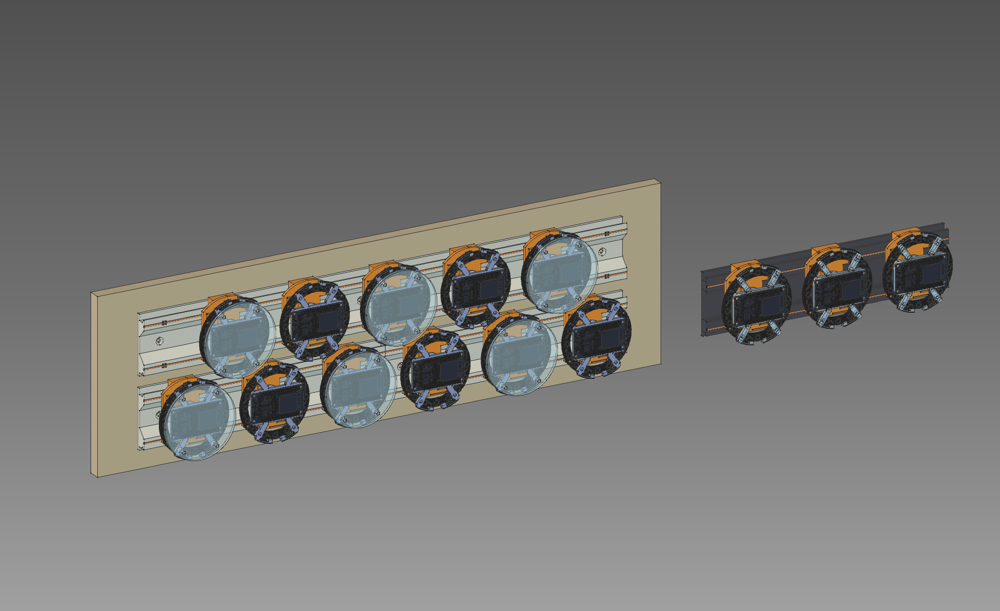
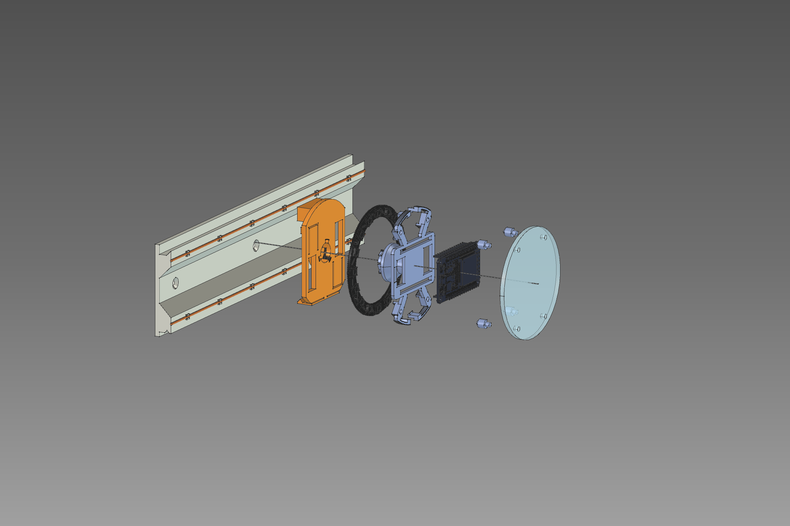
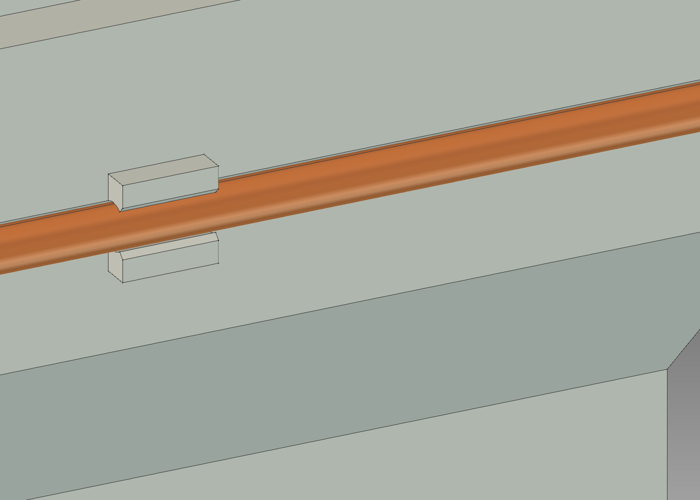
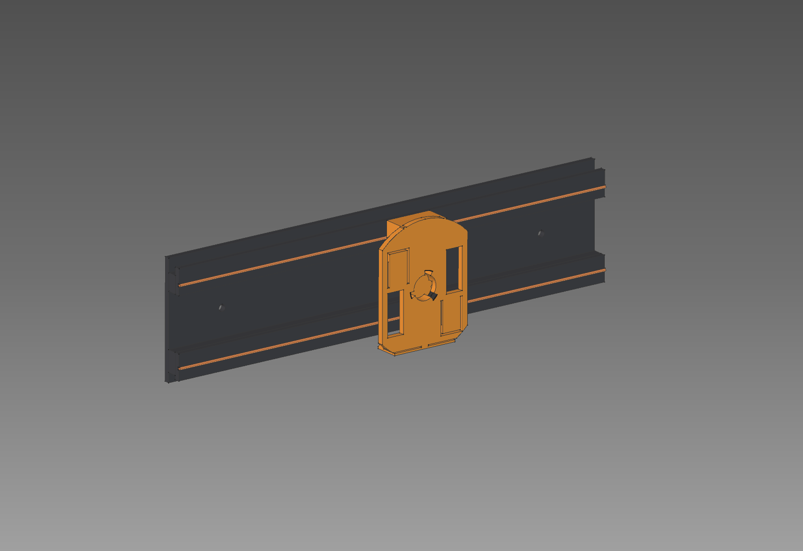
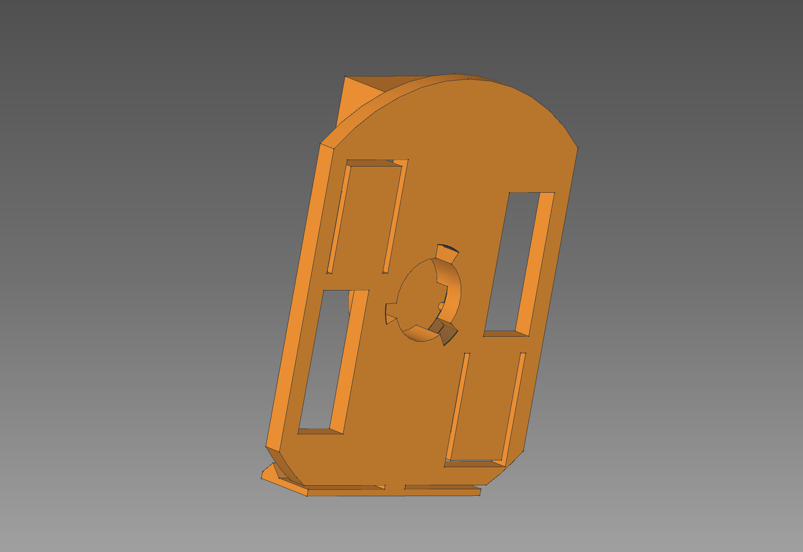
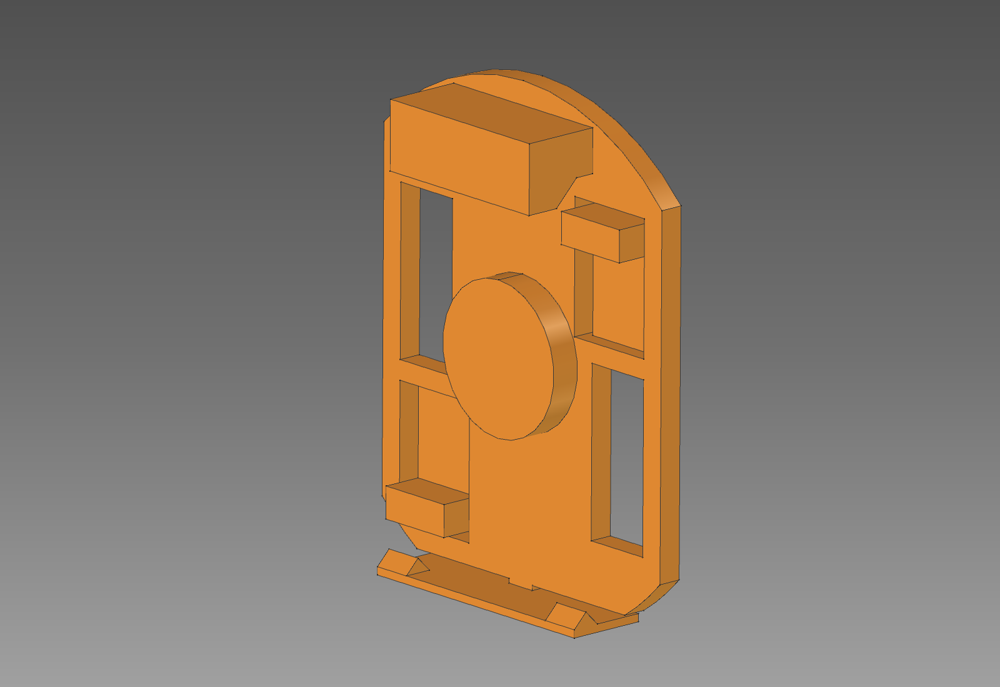
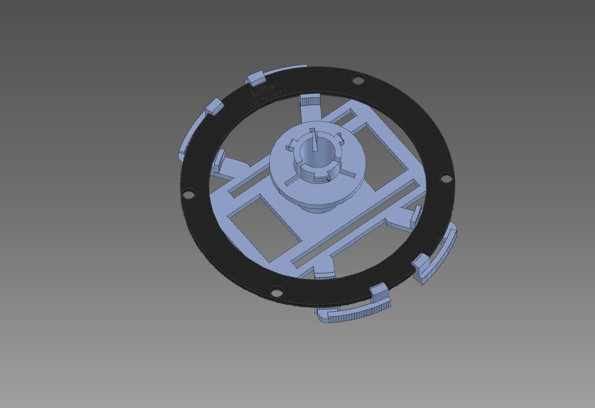
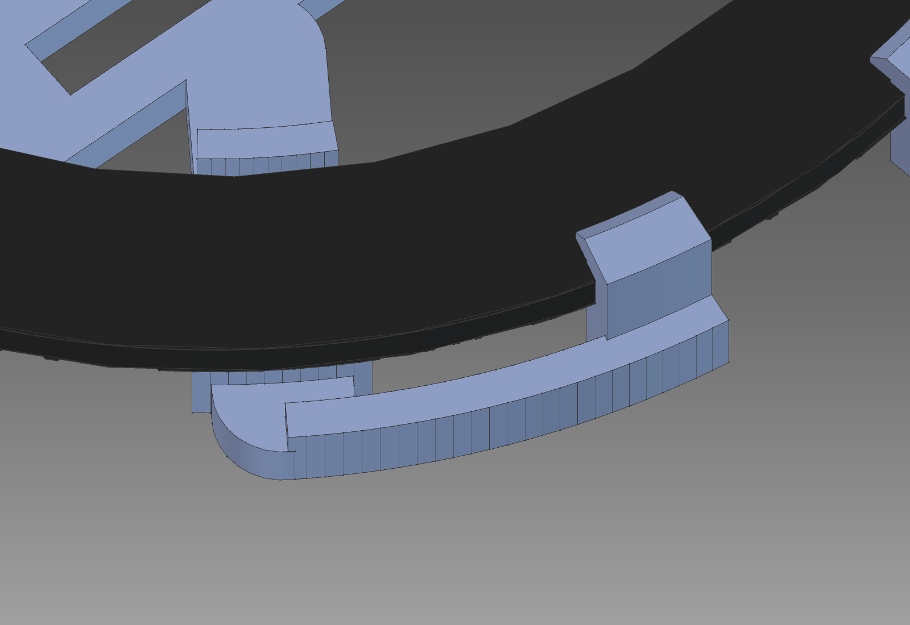
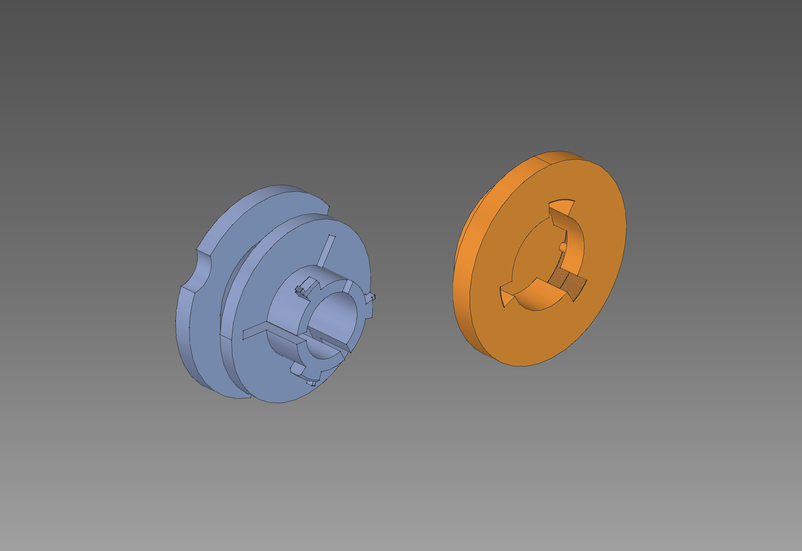

# HexNode RGB Wall (v02)

> **Archived version v02** (18 Nov 2026). This folder is a snapshot: the model is `HexNode_RGB_Wall_v02.FCStd`, the scripts are in `scripts/`, and the files in `export/print/`, `export/step/` and `export/laser/` carry a `_v02` suffix where their name didn't already include it (for example `export/print/Hub_acrylic_v02.stl`). File names in the text below are the ones the live project used. `HexNode_RGB_Wall_v02_bundle.zip` holds all of this plus the licence and the `ref/` files.

An interactive LED wall from Maker's Asylum, developed from the [DevCon8 2026 RGB Interactive Wall](https://github.com/MakersAsylumIndia/DevCon8_RGB_Wall). Each node is one ESP32, one 16-LED WS2812B ring and one touch input. Touching a node should send light ripples across the wall. The nodes talk to each other over ESP-NOW, so the wall only has to carry power.

**This is version 02, a set of test parts.** Nothing in v02 has been printed yet. Print the bayonet coupons first, then one node, before committing to a design. v01 is archived in [`../v01/`](../v01/).

- **The wall.** Rail strips go in horizontal rows on any non-conductive wall. Each strip has two rails. Bare copper wire on the top rail carries GND, and on the bottom rail +5V. The strips can be printed or laser-cut from acrylic layers.
- **The node.** A node back hooks over the top rail, latches under the bottom rail, and presses two copper-tape contacts onto the wires. A carrier holding the ESP32 and LED ring **twists into the node back** like a bayonet: push in, turn 45° until it clicks. The electronics come off with a twist, without unhooking the node from the wall.





## Test kit

| Part | Make it | Time (P1S, 0.20 mm, PETG) | Notes |
|---|---|---|---|
| `Bayonet_coupon_socket` + `Bayonet_coupon_hub` | Print | 8 + 13 min | Print these first. Same lugs, detent and clearances as the real parts. |
| `Rail_strip_v02` | Print | 71 min per 240 mm | v01 rail plus snap catches for the wire |
| `Node_back_v02` | Print | 21 min | For the printed rail |
| `Carrier_v02` | Print | 27 min | One piece: deck, four ring clips, bayonet hub |
| `Cover_standoff_x4` | Print | a few min | Optional, for the front cover |
| `laser/Front_cover_clear_2.8mm.dxf` | Laser, clear | | Optional; carries the touch electrode |
| `laser/Carrier_deck_acrylic_2.8mm.dxf` + `Hub_acrylic` + `Ring_clip_A_x2` + `Ring_clip_B_x2` | Laser, clear + print | 16 min + 6 min | Acrylic alternative to `Carrier_v02` |
| `laser/Lam_rail_*.dxf` + `Node_back_lam` | Laser + print | 22 min | Acrylic rail study, with its own node back |

Print time per node is a little more than v01: 48 min (node back + carrier), against 46 min for v01's node back + holder. v02's gains are robustness and access. See "Making it faster" below.

## The wall



- **Printed rail strip (`Rail_strip_v02`).** The same as v01: 240 × 58 mm, French cleat on top (GND), latch V-groove under the bottom rail (+5V), and a polarity key.
  - **New: wire catches.** Every 40 mm along each wire there's a 3 mm catch: two lips with a 0.9 mm mouth. The 1.38 mm wire snaps past them, which flexes each lip about 0.2 mm. The lips stop 0.1 mm below the top of the wire, so a contact pad that lands on a catch still touches the wire.
- **Acrylic rail (study; `laser/Lam_rail_*.dxf`).** Three layers glued flat: 2.8 mm base, 5.0 mm spacer bars, 2.8 mm cap bars, in 600 mm lengths.
  - The 45° cleat and V-groove can't be laser-cut, so the shapes change. The cap overhangs the spacer by 4 mm at the top, making a slot that a tongue on the node back drops into. At the bottom it overhangs by 2 mm, and the latch barb hooks behind that edge.
  - The wire sits in a 1.2 mm wide engraved groove on each cap and stands about 1.0 mm proud, the same as on the printed rail. It's held by tension and glue at the ends; there are no snap catches.
  - The polarity key still works (at least 121 mm³ of overlap upside down), and the node back stays inside the ring outline.
  - Bond the layers with acrylic solvent cement. Use pan-head screws, since a laser can't countersink. Black acrylic hides glue marks.
  - **Assessment:** it works. It cuts much faster than a 71-minute print and takes 600 mm lengths, but it needs its own node back (`Node_back_lam`) and three layers to align and glue. Worth one test length.



- **Layout.** Hex-offset rows, 80 mm apart along a row and 69.3 mm between rows. The rails are continuous, so a node can go anywhere along a row.
- **Edge loops.** At both ends of the wall, insulated wire ties together all the GND rails and all the +5V rails. Feed every row from both ends.

## The node

### Node back

 

- **Rail side unchanged from v01:** hook on the cleat, T latch into the V-groove, and copper-tape spring tabs that press 1.5 mm onto the wires.
- **Tabs moved sideways** to make room for the bayonet socket in the middle. The GND tab is 15 mm to the right, the +5V tab 15 mm to the left.
- **No posts, snap arms or pogo pins.** The holder's snap arms broke, and the posts got in the way of the JST plugs, so both are gone, along with the pogo pin option.
- **Bayonet socket:** a keyhole through the plate, with a lug cavity in a boss on the wall side. The boss fits between the rails.
- **Lightening windows** where the plate carries nothing.
- Still prints front face down, with no supports. The cavity roof is a short bridge.

### Carrier

 

- **ESP32:** the board's two header strips press into slots in a 2 mm deck. Nothing covers the front of the board, which stays fully visible. The deck is as thick as the header strips' plastic, so the JST plugs seat fully on the pins.
- **JST plugs:** both plugs sit on the three pins nearest the USB end (VIN/GND/D13 and 3V3/GND/D15). The whole area behind them is clear up to the hub flange, with 1.9 mm spare.
- **Ring:** held by its edges only, not its mounting holes (those differ between suppliers). Four clip stations sit in gaps between LEDs, each with:
  - a **seat** under the ring's front face;
  - an **inner stop** just inside the ring's inner edge (ID);
  - a **sprung hook** one LED further round, which presses on the outer edge (OD) and laps 1.0 mm over the ring's back face. Its 14 mm curved arm bends outwards.
  - **Sizes.** Set `LedRingID` and `LedRingOD` to your measured ring. The clips then take any ring within ±1 mm of those diameters (`RingTol`). Across that range the hooks flex 0.3–1.3 mm and press with 0.5–2 N each, at no more than 1.4 % strain. The inner stops leave a gap of 0.2–1.2 mm. I checked all nine combinations of ID and OD at −1, 0 and +1 mm; none clash except at the hooks, which are meant to flex.
  - **Fitting.** Turn the ring so the LEDs sit between the clips, then push it on from the back. The hooks' chamfers spread them and they click over the edge. To remove it, pull the four hooks outwards.
  - The ring sits 3 mm further back than in v01, so the LEDs clear the deck. The LEDs still face the viewer.
- **Bayonet hub:** a Ø12 tube with three lugs on sprung fingers, plus a Ø24 flange that bears on the plate's front face to stop wobble.
  - One lug is wider, so the carrier fits only one way: USB end to the right.
  - Push it in turned 45° anticlockwise, then turn it clockwise until it clicks. A small nub on each lug rides over a bump in the socket only in the last 4–13° of the turn. Each lug overlaps the plate by 1.15 mm.
- **Prints** front face down, with no supports, in PETG.

### Front cover and touch

- An optional Ø70 mm disc of 2.8 mm clear acrylic sits 0.8 mm in front of the USB socket, on four printed standoffs that plug into the ring pads.
- Stick copper tape on the back of the disc and solder the D13 touch wire to it. Capacitive touch works through the acrylic. The ESP32 stays visible through the clear disc.
- Pull the cover off to plug in USB. The peg holes are 3.0 mm for 2.85 mm pegs: adjust `AcrHoleD` to your laser's kerf for a press fit, or add a drop of glue.

### Acrylic carrier option

- `Carrier_deck_acrylic_2.8mm.dxf` in clear acrylic replaces the printed deck, so even the deck behind the board is see-through.
- `Hub_acrylic` is glued (epoxy, or CA on the rough side) to the deck's back face, inside the engraved circle.
- Four separate ring clips (`Ring_clip_A` ×2, `Ring_clip_B` ×2, mirror images) are glued onto the deck's four spokes.
- The cover standoffs have a flat side and print lying down.

### Node wiring

| Wire | Goes to |
|---|---|
| GND tab (top, right) | GND wire of the VIN/GND/D13 plug |
| +5V tab (bottom, left) | VIN wire of the same plug |
| Copper tape on the cover | D13 wire of the same plug |
| Ring | The 3V3/GND/D15 plug, as before |

Wrap the copper tape over each tab's pad and round its end, then solder the wire on the node side. Put a 470–1000 µF capacitor across VIN and GND. The wires flex a little when the carrier turns 45°; leave a little slack.

## Making it faster

Print time per node is unchanged so far. These are the ways to cut it, in order of payoff:

1. **Acrylic rails:** saves 71 min of printing per 240 mm, which is most of the print time on a wall.
2. **Acrylic carrier deck:** the remaining printed part, `Hub_acrylic`, takes 16 min against 24 min for `Carrier_v02`.
3. **Thinner node plate:** set `NodePlateT` to 2.4 and widen the lightening windows. That's roughly a 15 % saving, and needs checking against the tabs.
4. **0.28 mm layers:** none of these parts have fine detail except the bayonet lugs.

## Building it

1. **Test the bayonet.** Print the two coupons (`Bayonet_coupon_socket`, `Bayonet_coupon_hub`).

   

   Push the hub in turned 45° anticlockwise, turn it clockwise, and check the click. If it's too stiff or too loose, change `DetentI` (0.4) or `KeyClr` (0.25).
2. **Print** in PETG. All the STLs in `export/print/` are already in print orientation.
3. **Mount the strips and lay the wire.** Press the wire into the catches, anchor it at both row ends, and wire the edge loops with a fuse per row.
4. **Node back:** fit the copper tape to both tabs and solder the GND and VIN wires.
5. **Carrier:** press the ESP32's header strips into the slots. Push the ring into its four clips from the back, LEDs facing out, with the LEDs between the clips. Plug in the two JST plugs.
6. **Join them:** solder the node back's wires to the VIN/GND plug, then twist the carrier into the node back.
7. **Hang it:** hook the top over the top rail and swing the bottom in until it clicks.

## Power

| | |
|---|---|
| Per node, worst case | 16 LEDs × 60 mA × 90/255 (firmware brightness) ≈ 0.34 A, plus ESP32 with ESP-NOW ≈ 0.15–0.25 A, so about **0.5–0.6 A** |
| Row of 9 nodes | About 5 A |
| Rail drop | 1.5 mm² copper is 0.0115 Ω/m. On a 0.72 m row fed from both ends, the drop is about **10 mV** across +5V and GND together. Copper tape (5 mm × 0.035 mm) would be about 8× worse. |
| Supply | 5 V, sized at 0.6 A per node plus 20 % (the demo wall's 17 nodes need about 12 A). Put one resettable fuse per row: Yageo BK30-500 (5 A) or BK30-300 (3 A). |


## Parts and sourcing

Prices were checked on 15 Nov 2026. "Unverified" means the price came from a search snippet, not a product page.

**Other parts**

| Part | Source | Price |
|---|---|---|
| Copper tape, 10 mm, conductive adhesive | [Robocraze](https://robocraze.com/products/10mm-conductive-copper-tape-adhesive), [Electroncomponents 10 mm × 30 m](https://www.electroncomponents.com/copper-double-sided-tape-30m-10mm) | ₹306; ₹249 + GST |
| Bare copper wire, about Ø1.4 mm (17 SWG) or 1.5 mm² solid | Local wire shops: ask for **solid** core, since most 1.5 mm² wire is stranded. [IndiaMART listings](https://m.indiamart.com/impcat/bare-copper-wire.html) | About ₹700–1,200/kg (unverified); 1 kg is about 75 m |
| 1000 µF 16–25 V capacitor | [Robocraze 25 V](https://robocraze.com/products/1000uf-25v-electrolytic-capacitor-through-hole-dip), [Evelta 16 V](https://evelta.com/1000uf-16v-electrolytic-capacitor) (sold out) | About ₹6 (unverified) |
| Resettable fuse, 5 A / 3 A | [Yageo BK30-500](https://www.digikey.in/en/products/detail/yageo/BK30-500-SZ/15855858), [BK30-300](https://www.digikey.in/en/products/detail/yageo/BK30-300-SZ/13689577) | ₹51 / ₹35 (unverified) |


## Files

| File | What it is |
|---|---|
| `HexNode_RGB_Wall.FCStd` | The FreeCAD model. |
| `export/print/*.stl` | v02 print files, already in print orientation. A name ending `_xN` means print N of them. |
| `export/step/*.step` | The same parts as STEP, for other CAD tools. |
| `export/laser/*.dxf` | Laser-cut parts, in mm. Layer `CUT` is cut through; layer `ENGRAVE` is engraved (the wire grooves and the hub glue circle). |
| `export/renders/` | Pictures. |
| `scripts/v02.py` | Builds, checks and exports all v02 parts and the demo. |
| `scripts/wall.py` | v01 wall code, reused by v02 for the rail strip and parameters. |
| `scripts/hexnode.py` | The original holder rebuild (v01 reference). |
| `ref/` | The original holder, the ESP32 and ring models, BOM, circuit diagram, photos and feedback screenshots. |
| `../v01/` | Version 01. |

What's in `HexNode_RGB_Wall.FCStd`:

- **`V02Params`:** v02 parameters.
- **`WallParams`:** rail and contact parameters, shared with v01.
- **`V02Parts`:** the v02 parts.
- **`V02Demo`:** two rows of printed rail with 11 nodes, six of them with the clear cover, plus one acrylic rail with three acrylic-carrier nodes.
- **`Holder` with `Params`:** the original holder rebuild.
- **`Reference`:** the ESP32 and ring models.

## Changing the design

Shapes are generated by `scripts/v02.py`; a plain recompute doesn't regenerate them. Edit a cell in `V02Params` or `WallParams`, then run this in FreeCAD's Python console:

```python
import sys; sys.path.insert(0, "scripts")
import wall, v02
doc = App.getDocument("HexNode_RGB_Wall")
p = v02.params(doc); v02.make_parts(doc, p); v02.make_demo(doc, p); doc.recompute()
v02.export_v02(doc, "export")
```

| Cell | Default | What it does |
|---|---|---|
| `Twist`, `LugKeyArc`, `LugArc` | 45, 30, 20 | Bayonet turn and lug sizes |
| `DetentI`, `NubArc` | 0.4, 4 | Click strength, and how long the click lasts |
| `KeyClr`, `AxClr` | 0.25, 0.15 | Bayonet clearances: radial, and axial each side of the plate |
| `FlangeR` | 12 | Hub flange: bigger means less wobble |
| `CarrierGap` | 17 | Plate to ESP32 board: room for the JST plugs and wires |
| `HdrSlotW` | 2.6 | Header strip press fit |
| `LedRingID`, `LedRingOD`, `LedRingT` | 54, 68, 1.6 | **Measure your ring and enter these.** |
| `RingTol` | 1.0 | Diameter range the clips accept, ± |
| `LedCount`, `ClipAng` | 16, 56.25 | Clips go in LED gaps: 11.25 + k × 22.5° for 16 LEDs |
| `ClipPre`, `LipD` | 0.3, 1.0 | Hook preload at the largest ring; lip overlap |
| `ArmW`, `ArmH` | 1.4, 3 | Hook spring arm: wider is stiffer |
| `LedClr` | 0.3 | Ring spacing behind the deck |
| `TabX` | 15 | Sideways position of the contact tabs |
| `CatchGap`, `CatchPitch` | 0.9, 40 | Wire catch mouth and spacing |
| `AcrT`, `AcrHoleD` | 2.8, 3.0 | Acrylic thickness and standoff peg holes (adjust for kerf) |
| `Lam*` | | Acrylic rail layer thicknesses and heights |
| `TabPreload`, `TabT`, `LatchE`, `NotchClr` (`WallParams`) | 1.5, 1.0, 1.5, 0.15 | Contact spring and latch, as in v01 |

## Version history

- **v01** (17 Nov 2026), archived in [`../v01/`](../v01/): French cleat rail strips, a node back with copper-tape or pogo pin contacts, and the original holder extended with posts and snap arms. Test prints showed that the holder's snap arms broke and that its posts blocked the JST plugs.
- **v02** (17 Nov 2026), test parts, not yet printed:
  - Wire catches on the rail.
  - A bayonet twist-lock between the node back and a new carrier.
  - The ESP32 held by its header strips.
  - The ring held at its edges by four sprung clips, sized from the measured ID and OD.
  - An optional clear acrylic touch cover.
  - Acrylic options for the carrier deck and the rail.
  - Pogo pins dropped.

## License

Licenses

<a href="LICENSE.md"></a>

#### Hardware
CERN Open Hardware License Version 2 - Strongly Reciprocal ([CERN-OHL-S-2.0](https://spdx.org/licenses/CERN-OHL-S-2.0.html)).

#### Software
MIT open source [license](http://opensource.org/licenses/MIT).

#### Documentation:
<a rel="license" href="http://creativecommons.org/licenses/by/4.0/"></a><br />This work is licensed under a <a rel="license" href="http://creativecommons.org/licenses/by/4.0/">Creative Commons Attribution 4.0 International License</a>.
