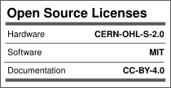

# Licenses

Copyright (c) 2026 Maker's Asylum

This project is released under three licences, one for each kind of material.

## Hardware

CERN Open Hardware Licence Version 2, Strongly Reciprocal ([CERN-OHL-S-2.0](https://spdx.org/licenses/CERN-OHL-S-2.0.html); [full text](https://ohwr.org/cern_ohl_s_v2.txt)).

This licence covers the design files:
- the FreeCAD model `HexNode_RGB_Wall.FCStd`;
- the print, laser and CAD files in `export/` (`.stl`, `.step`, `.dxf`) and any sliced plates (`.gcode.3mf`);
- the reference models in `ref/` (`.brep`, `reference_parts.zip`), the bill of materials `ref/BOM.csv` and the circuit diagram `ref/circuit_image.png`.

## Software

MIT open source [license](http://opensource.org/licenses/MIT).

This licence covers the scripts in `scripts/`.

> Permission is hereby granted, free of charge, to any person obtaining a copy of this software and associated documentation files (the "Software"), to deal in the Software without restriction, including without limitation the rights to use, copy, modify, merge, publish, distribute, sublicense, and/or sell copies of the Software, and to permit persons to whom the Software is furnished to do so, subject to the following conditions:
>
> The above copyright notice and this permission notice shall be included in all copies or substantial portions of the Software.
>
> THE SOFTWARE IS PROVIDED "AS IS", WITHOUT WARRANTY OF ANY KIND, EXPRESS OR IMPLIED, INCLUDING BUT NOT LIMITED TO THE WARRANTIES OF MERCHANTABILITY, FITNESS FOR A PARTICULAR PURPOSE AND NONINFRINGEMENT. IN NO EVENT SHALL THE AUTHORS OR COPYRIGHT HOLDERS BE LIABLE FOR ANY CLAIM, DAMAGES OR OTHER LIABILITY, WHETHER IN AN ACTION OF CONTRACT, TORT OR OTHERWISE, ARISING FROM, OUT OF OR IN CONNECTION WITH THE SOFTWARE OR THE USE OR OTHER DEALINGS IN THE SOFTWARE.

## Documentation

 This work is licensed under a <a rel="license" href="http://creativecommons.org/licenses/by/4.0/">Creative Commons Attribution 4.0 International License</a>.

This licence covers the written material and images: `README.md`, `LICENSE.md`, the renders in `export/renders/` and the photos in `ref/`.

## Names and logos

The Maker's Asylum name and logo are not covered by these licences.
